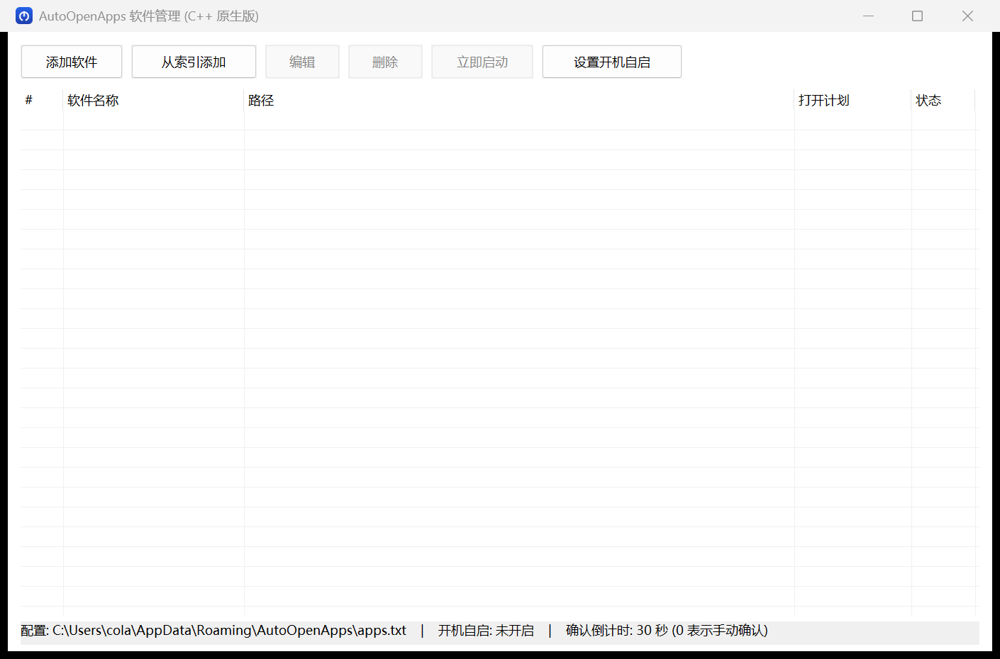
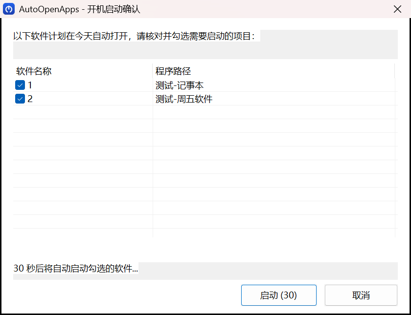
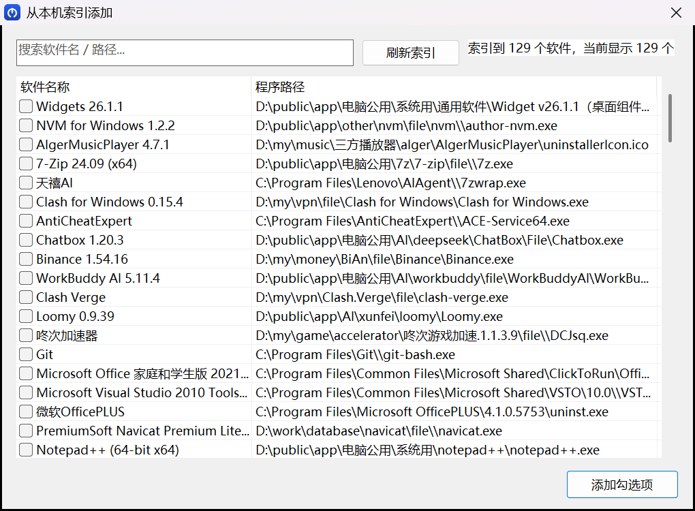

# AutoOpenApps

开机后自动帮你打开常用软件的 Windows 小工具。**C++ / Win32 原生实现，单个 exe 仅约 1MB**，无需安装 Python、.NET 或任何运行库。



## 功能

- 开机登录后自动弹出 **启动确认窗口**：勾选需要打开的软件，点击“启动”或等倒计时结束自动打开
- 每个软件可设置 **按星期打开**（例如工作日一套、周末一套）
- **本机软件索引**：自动扫描已安装软件，复选框批量添加；搜索过滤不会清空已勾选项
- 手动添加 / 编辑 / 删除软件，支持文件浏览选择 exe
- “立即启动”选中的软件
- 一键 **创建 / 移除开机自启**（写入用户启动文件夹，无需管理员权限）
- 确认倒计时时长可配置（0 = 关闭自动倒计时，改为手动确认）





## 环境要求

- Windows 10 / 11 x64
- 无任何运行时依赖

## 使用方法

1. 从 [Releases](../../releases) 下载 `AutoOpenApps.exe`（单文件，约 1MB）
2. 双击打开管理窗口，添加常用软件（可从本机索引批量勾选）
3. 点击 **设置开机自启**，会在启动文件夹创建快捷方式
4. 下次开机登录后自动弹出确认窗口，勾选后启动即可

配置保存在 `%APPDATA%\AutoOpenApps\`，仅存于本机，**不联网、不上传任何数据**。

## 从源码编译

需要任意 MinGW-w64 工具链（g++ ≥ 9，含 windres）：

```bash
cd src
windres -c 65001 app.rc -O coff -o app.res
g++ -std=c++17 -O2 -municode -mwindows -DUNICODE -D_UNICODE \
    -static -static-libgcc -static-libstdc++ -s \
    main.cpp app.res -o AutoOpenApps.exe \
    -lole32 -loleaut32 -luuid -lcomctl32 -lcomdlg32 \
    -lshell32 -ladvapi32 -lgdi32 -lshlwapi
```

Windows 下也可直接运行 `src/build.sh`（需将 g++ 所在目录加入 PATH）。

## 目录结构

```
src/         C++ 源码（Win32 API，主体在 main.cpp）
python/      旧版 Python / Qt 实现（仅供参考，体积较大）
screenshots/ 界面截图
```

## 隐私说明

软件不联网、不上传任何数据；软件列表与配置仅保存在本机 `%APPDATA%\AutoOpenApps\`。仓库内截图均为演示环境数据。

## License

[PolyForm Noncommercial 1.0.0](LICENSE) —— 允许个人复用、修改与分发，**禁止商用**。
